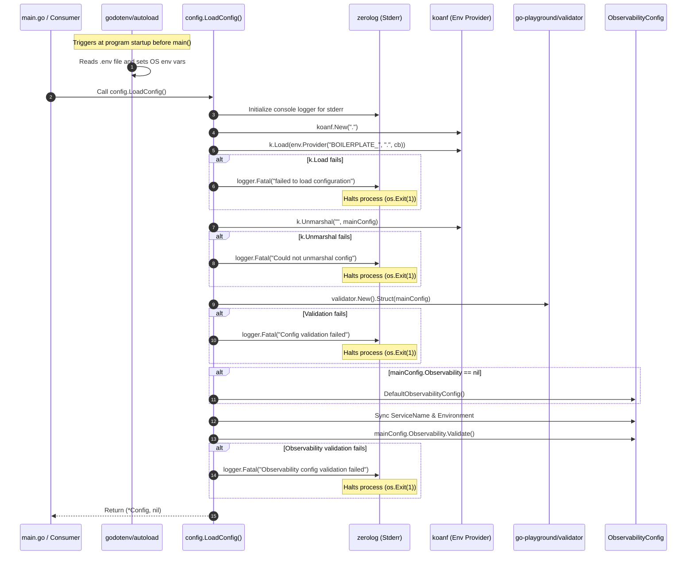

# Go Boilerplate Learning Notes

## 1. Configuration Module — `backend/internal/config/config.go`

- **Source File:** [`backend/internal/config/config.go`](file:///d:/project/go-boilerplate/backend/internal/config/config.go)
- **Direct Companion File:** [`backend/internal/config/observability.go`](file:///d:/project/go-boilerplate/backend/internal/config/observability.go)
- **Module Package:** `config`
- **Primary Entrypoint:** `LoadConfig() (*Config, error)`

---

### Purpose

The `config` module is the **central nervous system** of the backend application. In production software (following [Twelve-Factor App](https://12factor.net/config) methodology), an application must never hardcode database credentials, listening ports, secret keys, or timeouts inside source code. Instead, configuration is injected at runtime via environment variables or `.env` files.

The purpose of `config.go` is to:
1. Automatically load local `.env` files during development.
2. Define a strictly typed Go data contract (`struct`) representing every configurable aspect of the system (Server, Database, Redis, Auth, Observability).
3. Read environment variables prefixed with `BOILERPLATE_`.
4. Parse and unmarshal those values into Go types (converting string numbers to integers, slices, etc.).
5. Validate that all mandatory parameters are present and conform to required formats before the application starts up.
6. Apply default configurations and environment fallbacks for observability (logging, metrics, tracing).
7. Fail fast and crash immediately if any configuration is missing or malformed, preventing the server from running in a corrupted or insecure state.

---

### Responsibilities

The module implements 8 distinct responsibilities:

1. **Automatic `.env` File Discovery & Loading**: Automatically detects and loads key-value pairs from a local `.env` file into the OS environment variables without requiring manual shell exporting.
2. **Type-Safe Configuration Schema Definition**: Defines nested Go `struct` models with field tags to represent the application's configuration hierarchy.
3. **Dedicated Early Bootstrapping Logger**: Creates a zero-allocation, structured console logger (`zerolog`) specifically to format and report configuration loading failures before the global application logger is initialized.
4. **Environment Variable Reading & Prefix Filtering**: Reads OS environment variables, filters only those starting with `BOILERPLATE_`, and normalizes keys to lowercase.
5. **Configuration Data Unmarshaling (Binding)**: Hydrates hierarchical configuration keys into Go struct memory locations using reflection-based decoding (`koanf`).
6. **Strict Schema & Requirement Validation**: Inspects unmarshaled struct fields using validation rules (`validate:"required"`) to ensure zero missing parameters.
7. **Observability Defaults & Cross-Module Synchronization**: Injects sensible fallback values if the observability section is omitted, and syncs the service name and environment (e.g. `development`, `production`) from the primary configuration.
8. **Observability Business Rule Validation**: Executes custom domain validation checks on observability parameters (log level validation and non-negative slow query thresholds).

---

### Responsibility-to-Code Mapping

| No. | Responsibility | Function / Method | Struct / Field | Actual Code Location | Implementation Status |
|---|---|---|---|---|---|
| 1 | Auto-load `.env` file into process environment | Side-effect `init()` in imported package | N/A | `config.go` Line 7: `_ "github.com/joho/godotenv/autoload"` | External functionality provided by dependency |
| 2 | Define strongly typed configuration schema | N/A (Type declarations) | `Config`, `Primary`, `ServerConfig`, `DatabaseConfig`, `RedisConfig`, `AuthConfig` | `config.go` Lines 14–54 | Implemented |
| 3 | Dedicated console logger for config bootstrap | `LoadConfig()` | `zerolog.Logger` | `config.go` Line 57: `logger := zerolog.New(...)` | Implemented |
| 4 | Filter, transform, and load env variables | `LoadConfig()` | `k.Load(env.Provider(...))` | `config.go` Lines 58–63 | Implemented |
| 5 | Unmarshal env key-values into Go struct hierarchy | `LoadConfig()` | `k.Unmarshal("", mainConfig)` | `config.go` Line 70 | Implemented |
| 6 | Validate configuration presence & constraints | `LoadConfig()` | `Validate.Struct(mainConfig)` | `config.go` Lines 75–77 | Implemented |
| 7 | Fallback defaults & cross-field synchronization | `LoadConfig()` | `mainConfig.Observability` | `config.go` Lines 82–88 | Implemented |
| 8 | Observability business rules validation | `LoadConfig()` calls `ObservabilityConfig.Validate()` | `mainConfig.Observability.Validate()` | `config.go` Line 89 (defined in `observability.go` Lines 60–79) | Implemented (delegated to companion file) |
| 9 | Applying Server/DB timeouts & connection pools | `New(...)` in `database` package / HTTP server | `ServerConfig`, `DatabaseConfig` fields | Declared in `config.go` Lines 27–46; consumed in `backend/internal/database/database.go` | **Configured-only** (Values are collected here, but applied by consumer modules) |

---

### Execution Flow

The following sequence diagram illustrates how `LoadConfig()` executes:



---

### Important Go Concepts

#### 1. Blank Import (`_ "package"`) for Side Effects
- **What it is:** In Go, importing a package without using its exported identifiers causes a compilation error. Using an underscore `_` tells Go: *"Run this package's `init()` function, but I will not call its types or functions directly."*
- **In this module:** `_ "github.com/joho/godotenv/autoload"` automatically searches for a `.env` file in the working directory when the binary boots up and populates `os.Environ()`.

#### 2. Struct Tags (Field Metadata)
- **What it is:** Backtick strings after struct field types:
  ```go
  Port string `koanf:"port" validate:"required"`
  ```
- **How it works:** Struct tags attach compile-time metadata to fields. Libraries like `koanf` and `validator` use Go's `reflect` package at runtime to read these tags and determine which key to map or what validation rule to enforce.

#### 3. Pointers and Allocation (`&Config{}`)
- **What it is:** The `&` operator gets the memory address of a value, returning a pointer `*Config`.
- **Why it is used:** `k.Unmarshal` and `Validate.Struct` require a pointer so they can write data directly into the struct's allocated memory, rather than modifying a useless copy.

#### 4. Anonymous Functions (Lambdas / Closures)
- **What it is:** A function defined inline without a name:
  ```go
  func(s string) string {
      return strings.ToLower(strings.TrimPrefix(s, "BOILERPLATE_"))
  }
  ```
- **Why it is used:** `env.Provider` accepts a callback function as a strategy parameter so you can customize how environment variable keys are converted into configuration map keys.

#### 5. Composition vs Inheritance
- **What it is:** Go does not have class inheritance. Instead, complex models are built by composing structs inside other structs (`Primary Primary`, `Server ServerConfig`, `Observability *ObservabilityConfig`).

---

### Packages and APIs Used

| Package | Function / Type | Signature | Purpose & Behavior |
|---|---|---|---|
| `github.com/joho/godotenv/autoload` | Side-effect import | `init()` | Automatically loads `.env` file into process environment variables on startup. |
| `github.com/rs/zerolog` | `zerolog.New` | `func New(w io.Writer) Logger` | Instantiates a structured logger. Here it writes to `os.Stderr` via `zerolog.ConsoleWriter`. |
| `github.com/knadh/koanf/v2` | `koanf.New` | `func New(delim string) *Koanf` | Initializes an instance of the Koanf configuration manager with a hierarchy delimiter (e.g., `"."`). |
| `github.com/knadh/koanf/providers/env` | `env.Provider` | `func Provider(prefix, delim string, cb func(string) string) *Provider` | Creates a configuration provider that reads OS environment variables matching `prefix`. |
| `github.com/knadh/koanf/v2` | `(*Koanf).Unmarshal` | `func (k *Koanf) Unmarshal(path string, out any) error` | Parses internal hierarchical map entries into a target Go struct pointer using reflection. |
| `github.com/go-playground/validator/v10` | `validator.New` | `func New(opts ...Option) *Validate` | Instantiates a validator engine with default rule sets. |
| `github.com/go-playground/validator/v10` | `(*Validate).Struct` | `func (v *Validate) Struct(s any) error` | Inspects struct field tags (e.g. `validate:"required"`) and validates data rules. |

---

### How to Build This Module From Scratch

When starting a new Go microservice, follow this exact development sequence:

1. **Phase 1: Define the Domain Model (`Config` Structs)**
   - Group settings logically into sub-structs: Server, Database, Cache, Auth, Logging.
   - Attach metadata tags (`koanf` for mapping, `validate` for validation).
2. **Phase 2: Bootstrap Dependencies**
   - Import `godotenv` autoload.
   - Initialize a local console logger to catch startup faults.
3. **Phase 3: Setup Configuration Provider (`koanf`)**
   - Create a Koanf instance with a delimiter.
   - Add an environment provider with the application prefix.
4. **Phase 4: Unmarshal & Validate**
   - Allocate target config struct with `&Config{}`.
   - Call `k.Unmarshal("", cfg)`.
   - Run validator checks and custom domain validations.
5. **Phase 5: Return Config or Bubble Errors**
   - Return `(cfg, nil)` on success or wrap and return errors up to `main()`.

---

### Production Considerations & Critical Findings

#### 1. Anti-Pattern: `logger.Fatal()` Inside a Library Package
- **The Problem:** Lines 65, 72, 79, and 90 call `logger.Fatal(...)`. In `zerolog`, `Fatal()` calls `os.Exit(1)` after logging.
- **Why it matters:**
  - Calling `os.Exit(1)` inside an internal package terminates the whole process instantly.
  - It completely breaks unit testing: any test triggering an invalid configuration will crash the `go test` runner.
  - It violates Go idiomatic error handling: functions should return `(*Config, error)` and let `main()` decide whether to exit, retry, or fallback.
- **Fix:** Return wrapped errors (`return nil, fmt.Errorf("failed to load configuration: %w", err)`).

#### 2. Environment Variable Delimiter Mismatch in Koanf
- **The Problem:** `env.Provider("BOILERPLATE_", ".", func(s string) string { return strings.ToLower(strings.TrimPrefix(s, "BOILERPLATE_")) })` uses `.` as delimiter, but standard environment variables cannot contain dots (e.g. `BOILERPLATE_SERVER.PORT` is invalid syntax in POSIX shells).
- **Why it matters:** If an environment variable is named `BOILERPLATE_SERVER_PORT`, the callback produces `"server_port"`. Since there is no dot, Koanf does not nest it under `"server" -> "port"`. Consequently, `mainConfig.Server.Port` will be empty and `validator` will reject it!
- **Fix:** Use double-underscores for hierarchy nesting:
  ```go
  strings.ReplaceAll(strings.ToLower(strings.TrimPrefix(s, "BOILERPLATE_")), "__", ".")
  ```
  Allowing environment variables like `BOILERPLATE_SERVER__PORT=8080` to map seamlessly to `server.port`.

#### 3. Unspecified Units for Integer Timeouts
- **The Problem:** `ReadTimeout int`, `WriteTimeout int`, `ConnMaxLifetime int`.
- **Why it matters:** It is ambiguous whether these are seconds, milliseconds, or minutes.
- **Fix:** Use `time.Duration` with string unmarshaling (e.g. `"10s"`, `"5m"`), or rename fields explicitly: `ReadTimeoutSeconds int`.

#### 4. Credential Leakage in Debug / Error Logs
- **The Problem:** `Password` in `DatabaseConfig` and `SecretKey` in `AuthConfig` are plain strings.
- **Why it matters:** If an engineer logs `logger.Info().Interface("config", cfg).Msg("bootstrapping")`, plain text passwords and secret keys will be written to log files and external log collectors.
- **Fix:** Implement `fmt.Stringer` or custom redaction methods for sensitive configuration sub-structs.

---

### Related Files
- [`backend/internal/config/observability.go`](file:///d:/project/go-boilerplate/backend/internal/config/observability.go): Defines `ObservabilityConfig` and custom validation rules.
- [`backend/internal/database/database.go`](file:///d:/project/go-boilerplate/backend/internal/database/database.go): Consumes `cfg.Database` and `cfg.Primary` to establish PostgreSQL connection pools.
- [`backend/internal/logger/logger.go`](file:///d:/project/go-boilerplate/backend/internal/logger/logger.go): Consumes `cfg.Observability` to initialize New Relic and structured application logging.
